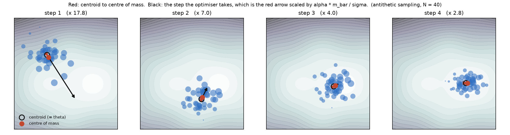
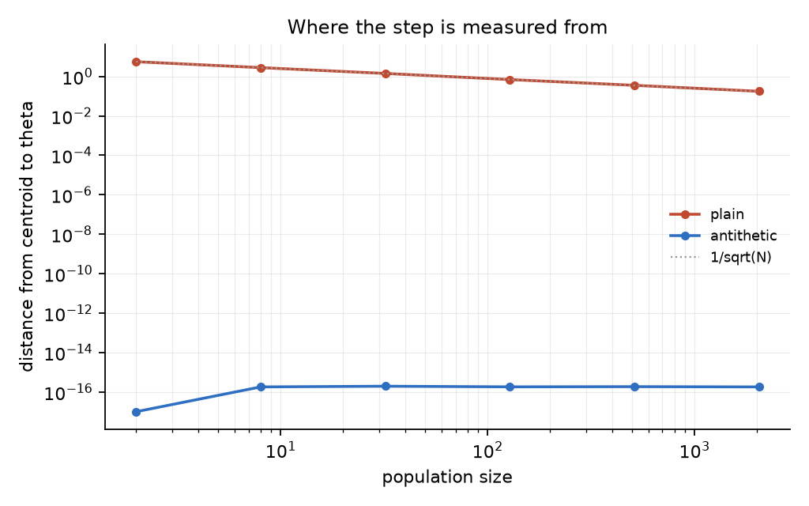

<h1 align="center">es-com</h1>

<p align="center">
  <a href="https://github.com/tatra-labs/es-com/actions/workflows/tests.yml"></a>
  <a href="https://arxiv.org/abs/2610.35865"></a>
  <a href="LICENSE"></a>
  
</p>

<p align="center"><b>An evolution-strategies step is not an estimate of anything. It is a displacement.</b><br>
Hang a mass on each perturbed model equal to its reward; the step is the shift in where the
population balances — exactly, for any population size, not in expectation.</p>

```
step 1  cos(gap, update) = 1.000000000000   |gap| 0.1941  x 17.79  =  |update| 3.4521
step 2  cos(gap, update) = 1.000000000000   |gap| 0.1345  x  6.96  =  |update| 0.9361
step 3  cos(gap, update) = 1.000000000000   |gap| 0.1135  x  4.04  =  |update| 0.4586
step 4  cos(gap, update) = 1.000000000000   |gap| 0.0926  x  2.83  =  |update| 0.2616
```

ES perturbs parameters into a population, scores it, and recombines:

```
p_i = θ + σ·ε_i                    Δθ = (α/N) · Σ w_i ε_i
```

Usually read as a Monte-Carlo estimate of a smoothed gradient — something that is only correct on
average, and gets less wrong as the population grows.
[*Center-of-Mass Interpretation of Evolution Strategies*](https://arxiv.org/abs/2610.35865)
(Akshat Gupta, October 2026) says it is something else, and something exact. Give particle `i` a
mass equal to its reward. Before the rewards arrive the population balances at its plain centroid
`p̄`; after they arrive it balances at the reward-weighted centre of mass `p_com`. Then for
mean-subtracted weights,

```
Δθ = (α·r̄ / σ) · (p_com − p̄)
```

No expectation, no limit, no assumption about the reward distribution. **es-com** is that identity
checked to the last bit, drawn, and pushed a little further than the paper takes it. No code was
released.

```bash
pip install -e ".[dev,experiments]"
python experiments/identity.py     # the identity, across every setting that matters
python experiments/visualise.py    # the picture above
pytest -q                          # 31 tests
```

## The picture



Particle area is the mass it carries. The red arrow runs from the centroid to the centre of mass;
the black arrow is the step the optimiser takes. They are the same arrow at different lengths — the
factor in each panel title is `α·m̄/σ`, and `cos` between them is `1.000000000000`.

The panels use antithetic sampling for a reason given below: it makes the centroid land exactly on
`θ`, so both arrows genuinely start from the model.

## Exact means exact

| population | parameters | σ | relative residual |
|---:|---:|---:|---:|
| 2 | 1 | 10 | 8.8e-16 |
| 64 | 16 | 0.1 | 5.1e-14 |
| 512 | 1024 | 10 | 8.6e-15 |
| 512 | 1024 | 1e-3 | 9.9e-11 |

<sub>`python experiments/identity.py`, across populations 2–512, dimensions 1–1024 and σ from 1e-3 to 10.</sub>

Worst case over the whole grid is **9.9e-11**, which is float64 rounding and not an approximation
error — a population of two agrees as readily as a population of 512.

### Three things that follow

**Adding a constant to every reward changes nothing.** The update is identical to twelve decimal
places whether the rewards are centred on 0 or on 1000 — while `p_com` genuinely moves and `r̄`
moves to compensate. This is what lets you insist on non-negative masses for the physical reading
without changing the algorithm.

**Antithetic sampling moves the reference point onto θ.** Mirroring each perturbation makes `ε̄`
exactly zero, so `p̄` is exactly `θ`:

| population | plain | antithetic |
|---:|---:|---:|
| 2 | 5.566 | 0.0e+00 |
| 128 | 0.693 | 1.8e-16 |
| 2048 | 0.176 | 1.8e-16 |

<sub>distance from the population's centroid to θ, σ = 1</sub>

Without it the gap closes as 1/√N, which is the sense in which "the centroid coincides with θ" is
usually true — asymptotically. With it, the step is a displacement measured from the model itself,
to the last bit, at a population of two.



**Mean subtraction changes only where you measure from.** Raw rewards give a displacement measured
from `θ`; mean-subtracted ones measure from the population's own centroid `p̄`. The destination,
`p_com`, is the same in both. Which is why the two coincide under antithetic sampling, where
`p̄ = θ`.

## Past where the paper stops

The paper writes the picture for mean-subtracted rewards and notes the masses can be made
non-negative by adding a constant. The same move generalises: **any weighting whose weights sum to
zero is a centre-of-mass displacement**, for the masses `m = w + c` with any `c` large enough to
lift them positive. Centred ranks and standardised rewards — what most implementations actually
use — are therefore the same geometry, not a different one:

| weighting | sums to zero | reference point | residual |
|---|---|---|---:|
| `raw` | no | θ | 1.7e-15 |
| `mean_subtracted` | yes | centroid | 1.2e-14 |
| `centred_rank` | yes | centroid | 3.3e-14 |
| `standardised` | yes | centroid | 1.5e-14 |

The constant `c` is arbitrary, and `as_masses(weights, floor=...)` takes it. Any floor gives the
same step, which is worth knowing before reading anything into how heavy the particles look.

## Two places the geometry is exact and the arithmetic is not

Worth saying plainly, because the identity being exact does not make the geometric form a good way
to *compute* anything.

* **Small σ.** The residual grows as σ shrinks — 8.6e-15 at σ = 10, 9.9e-11 at σ = 1e-3 — because
  the geometric form rebuilds a small displacement by subtracting two nearby points and dividing by
  σ. At the noise scales ES actually uses for large models, compute the step the ordinary way and
  keep the geometry for thinking.
* **Large floors.** The same cancellation appears if you lift the masses far above zero: residual
  1.4e-14 at `floor=1`, 1.7e-8 at `floor=1e6`. The constant is mathematically free and numerically
  is not.

Both are tested for the behaviour they have, rather than papered over with a loose tolerance.

## Using it

```python
import numpy as np
import es_com as es

noise = es.sample("antithetic", rng, population=64, parameters=1024)
models = es.perturb(theta, noise, sigma)
rewards = np.array([score(model) for model in models])

step = es.es_update(noise, es.mean_subtracted(rewards), alpha)      # the ordinary way
same = es.displacement_update(models, rewards, alpha, sigma)        # the geometric way

es.centroid(models)                     # p̄, where it balanced before the rewards
es.center_of_mass(models, rewards)      # p_com, where it balances after
es.identity_residual(noise, rewards, alpha, sigma, theta)   # how far apart the two are
```

## What is the paper's, and what is not

* **The interpretation is the paper's**: particles, masses, the two balance points, and the
  identity between the mean-subtracted update and the displacement between them.
* **The generalisation to any sum-to-zero weighting is not stated there**, as far as the abstract
  and the available text go. It follows immediately, it is written out in `as_masses`, and it is
  tested — but do not attribute it to the authors.
* **The numerical caveats are this repository's.** The paper is about geometry and makes no claim
  about floating point; the two failure modes above are what happens when you compute the
  geometric form anyway.
* This is an interpretation, not an algorithm. Nothing here makes ES converge faster, and the
  repository does not claim it does.

## Licence

MIT. Paper: [arXiv:2610.35865](https://arxiv.org/abs/2610.35865).
